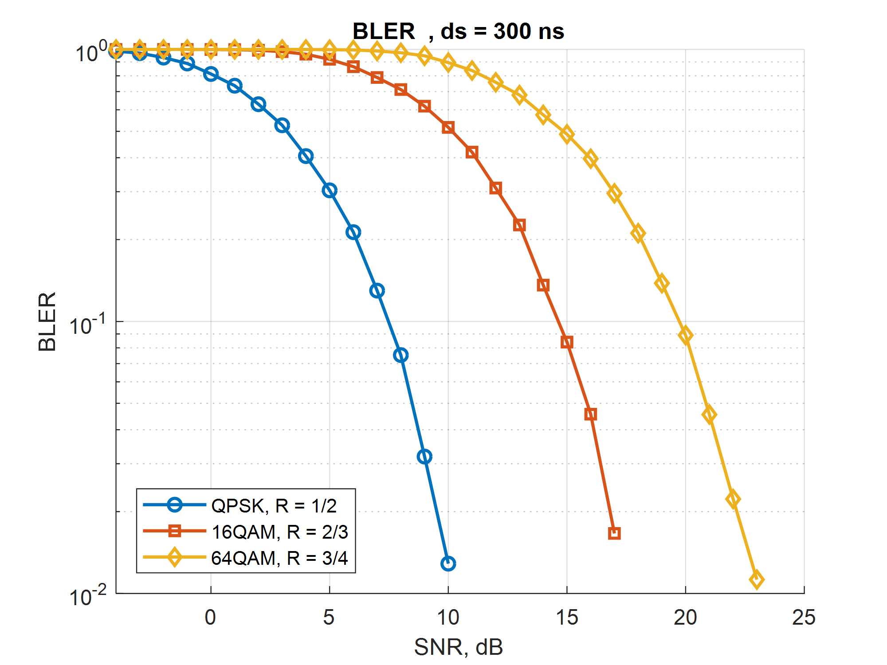
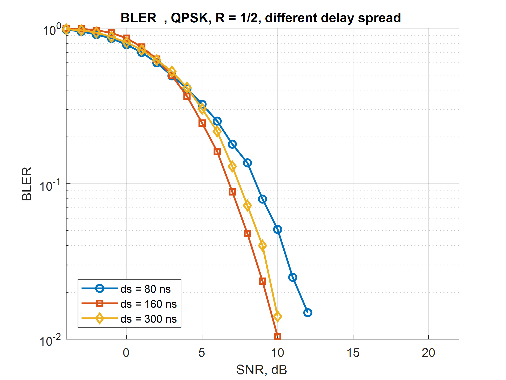
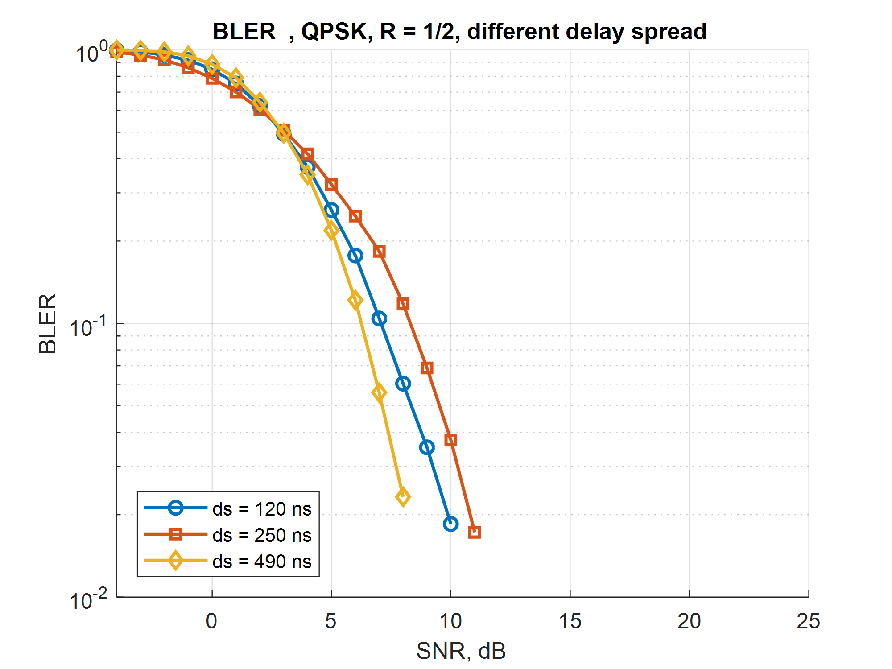
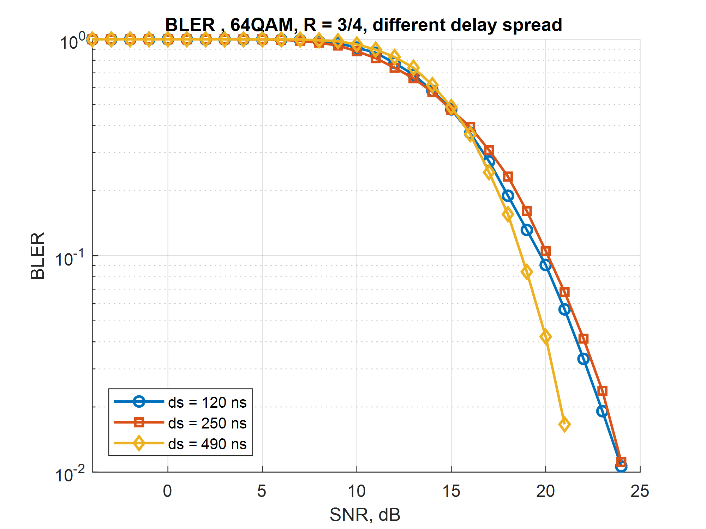
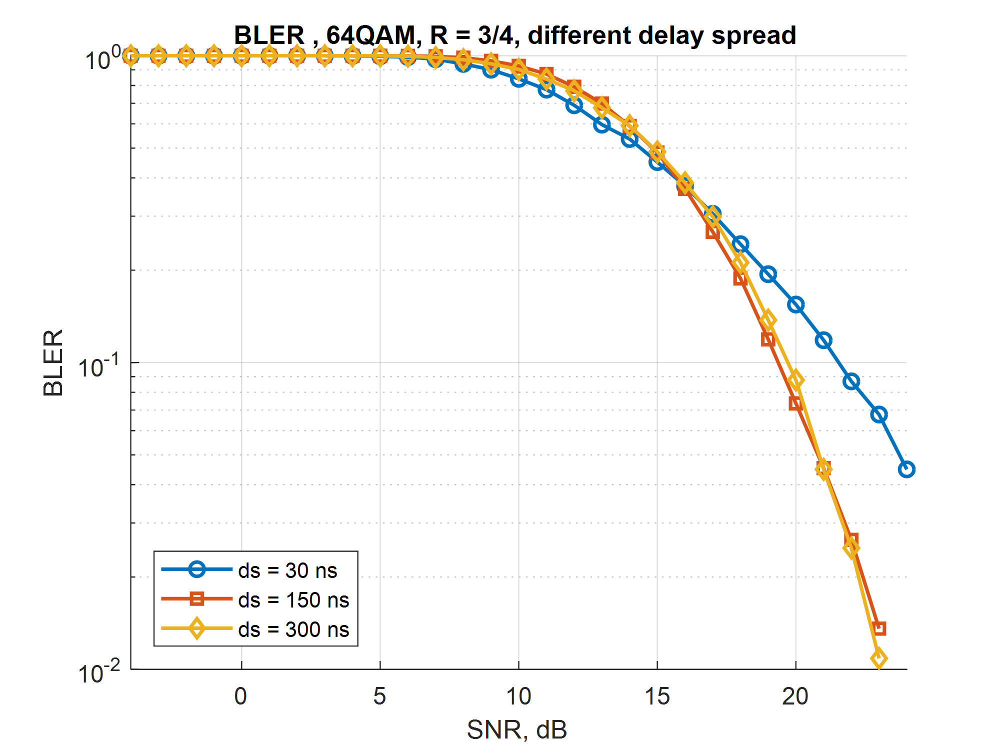

# OFDM turbo multipath modeling

Моделирование беспроводной системы связи с OFDM и турбо-кодированием в MATLAB. Исследуется, как отношение сигнал/шум, модуляция, скорость кодирования и многолучевое распространение влияют на качество приёма.

## Как устроена модель

- **Передатчик:** формирование информационных битов, добавление CRC, турбо-кодирование, согласование длины кодированного потока, модуляция, IFFT и циклический префикс.
- **Канал:** аддитивный белый гауссовский шум или многолучевой TDL-канал с шумом. Лучи имеют разные задержки, мощности и комплексные коэффициенты.
- **Приёмник:** удаление префикса, FFT, частотная эквализация Zero Forcing, мягкая демодуляция в LLR, восстановление кодового потока, турбо-декодирование и проверка CRC.

Турбо-кодирование добавляет избыточность для исправления ошибок. Мягкая демодуляция передаёт декодеру не только значения битов, но и степень уверенности в них.

## Что исследуется

Сравниваются три модуляционно-кодовые схемы:

| Модуляция | Скорость кодирования R |
| --- | --- |
| QPSK | 1/2 |
| 16QAM | 2/3 |
| 64QAM | 3/4 |

Эксперименты выполнены с FFT 512, разносом поднесущих 15 кГц, частотой дискретизации 7,68 МГц и циклическим префиксом 51 отсчёт. Для исследования многолучевого распространения используется профиль TDL-A с разными значениями RMS delay spread, среднеквадратичного разброса задержек лучей.

Качество приёма оценивается двумя метриками:

- **BER:** доля неверно восстановленных информационных битов.
- **BLER:** доля блоков, не прошедших проверку CRC после декодирования.

На графиках ниже показана зависимость BLER от SNR.

## Результаты

### Сравнение модуляций и скоростей кодирования

При delay spread 300 нс наименьший SNR для заданного BLER требуется схеме QPSK с R = 1/2. Схема 16QAM с R = 2/3 занимает промежуточное положение, а 64QAM с R = 3/4 требует более высокого SNR.

Повышение порядка модуляции позволяет передавать больше бит на символ, а повышение скорости кодирования уменьшает избыточность. Вместе с этим растут требования к качеству канала.

### Влияние delay spread на QPSK

Для QPSK с R = 1/2 сравниваются два набора задержек: 80, 160 и 300 нс, затем 120, 250 и 490 нс.

### Влияние delay spread на 64QAM

Для 64QAM с R = 3/4 рассмотрены значения 120, 250 и 490 нс, а также 30, 160 и 300 нс.

Изменение delay spread смещает кривые BLER, но увеличение разброса задержек не всегда ухудшает результат. Оно меняет частотную характеристику канала, расположение провалов и условия частотного разнесения для кодированного сигнала.

Итог исследования: качество приёма определяется совместным влиянием SNR, модуляционно-кодовой схемы и частотной селективности канала.
